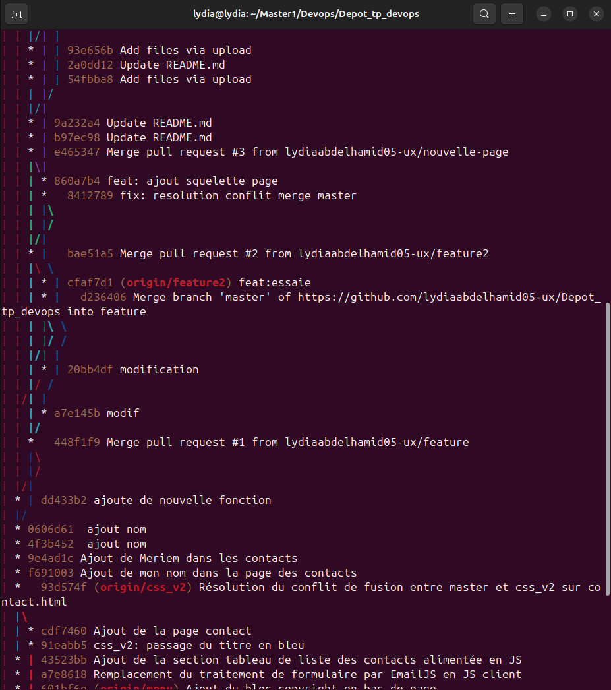
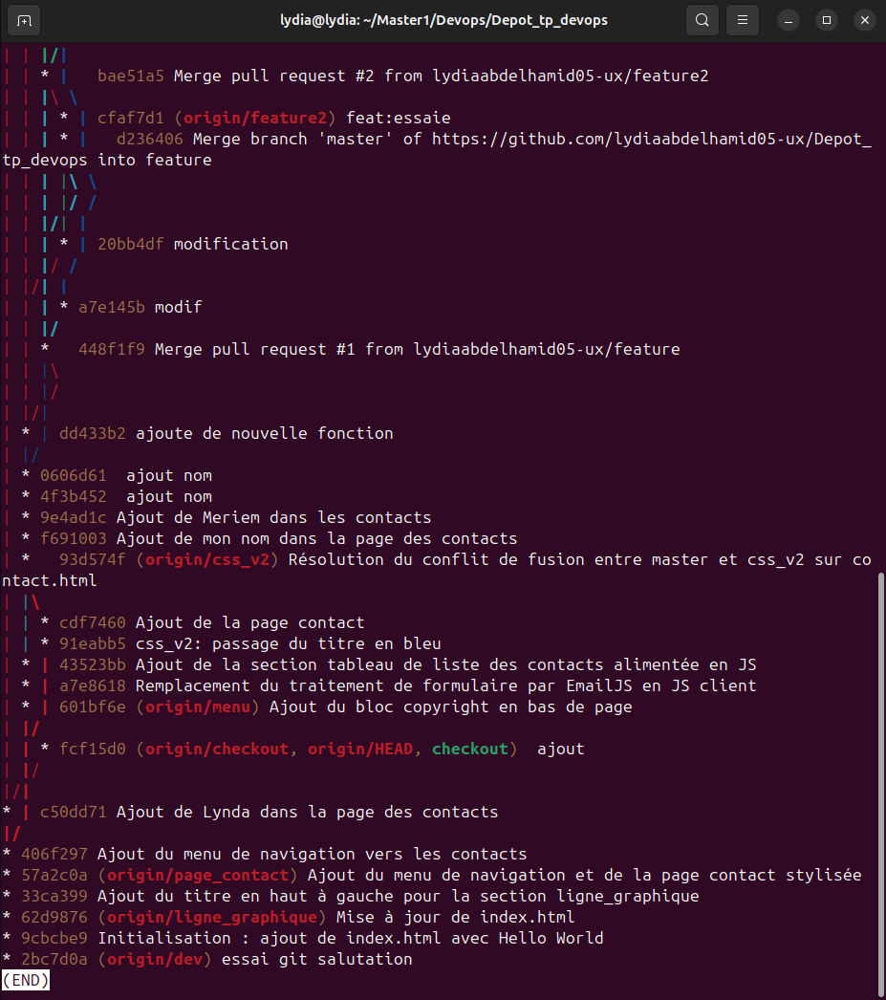

**Q1 :** Quelle est la différence entre `git push --force` et `git push --force-with-lease` ?

**Q2 :** Pourquoi privilégier `git rebase` plutôt que `git merge` ?

**Q3 :** Pourquoi utiliser le Squash dans un pipeline CI/CD ?
