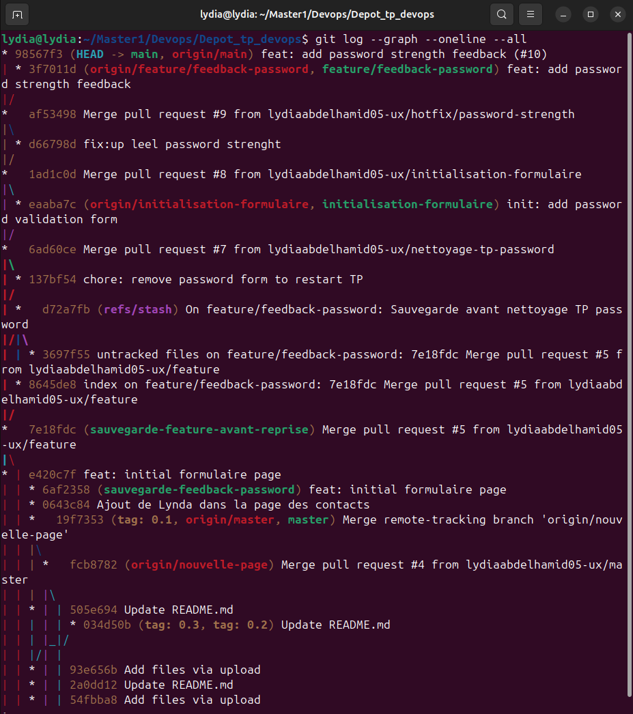

# TP — Conflits, Rebase & Code Review

**Auteurs :**
- Lydia Abdelhamid
- Lynda Kerbous

## 1. Captures du graphe Git

Commande utilisée :

```bash
git log --graph --oneline --all
```

### Capture 1


### Capture 2


### Capture 3


## 2. Questions et réponses

### Q1. Quelle est la différence entre `git push --force` et `git push --force-with-lease` ?

`git push --force` écrase l'historique distant sans vérifier les modifications des autres développeurs.

`git push --force-with-lease` vérifie que la branche distante n'a pas changé depuis la dernière récupération de son état. Cette commande est préférable en équipe, car elle évite d'écraser accidentellement le travail des autres.

### Q2. Pourquoi privilégier `git rebase` plutôt que `git merge` ?

`git rebase` permet de mettre à jour une branche en conservant un historique linéaire, sans ajouter de commit de fusion.

Cela rend l'historique plus clair et plus facile à suivre. Il faut cependant éviter de réécrire des commits partagés sans coordination.

### Q3. Pourquoi utiliser le Squash dans un pipeline CI/CD ?

Le Squash regroupe plusieurs commits en un seul commit propre.

Cela permet de simplifier l'historique Git, de faciliter la maintenance, de retrouver les modifications et de revenir plus facilement sur une fonctionnalité en cas de problème.
